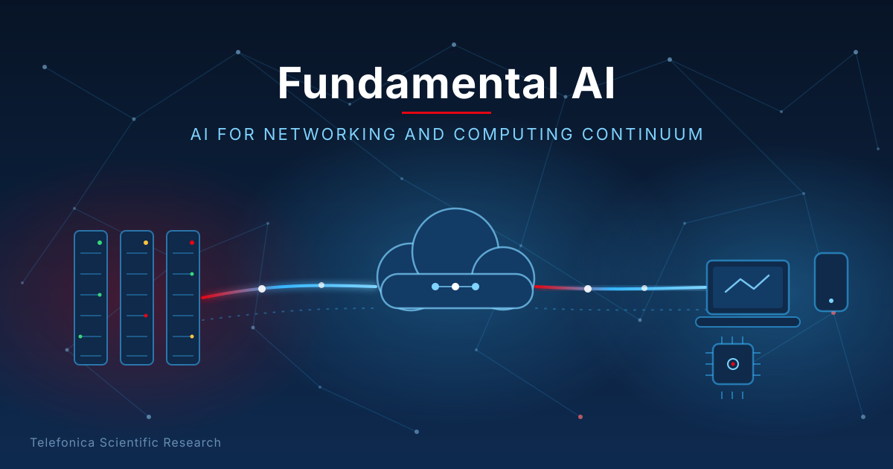

I am the **Team Lead** of the **Fundamental AI and AI for Networking and Computing Continuum** team at [Telefonica Scientific Research](https://www.telefonica.com/en/sustainability-innovation/innovation/).

My current research interests include:

- **AI for networking and the cloud/edge continuum** — scheduling, orchestration and management of distributed computing resources.
- **Machine learning and deep learning** — sparse methods, representation learning and efficient model architectures.
- **Computer vision and low-level image processing** — video alignment, segmentation and change detection.
- **Computational neuroscience and speech** — signal denoising and efficient speech models.

Previously, I worked at Robert Bosch GmbH (Corporate Research) and at the Heidelberg Collaboratory for Image Processing (HCI).

I am a Telecommunication Engineer by the Universitat Politècnica de Catalunya (UPC), and PhD in Computer Vision from the Computer Vision Center (CVC) and Universitat Autònoma de Barcelona (UAB).

---

## Recent News

<ul class="news-timeline">
  <li>March 2025. Our paper <a href="https://doi.org/10.1145/3721889.3721931">RemWoW: Resource Efficient Management of Workloads of Repeated Workflows</a> presented at MECC '25, the 2nd International Workshop on MetaOS for the Cloud-Edge-IoT Continuum (co-located with EuroSys 2025).</li>
  <li>2024. Became Team Lead of the Fundamental AI and AI for Networking and Computing Continuum team at <a href="https://www.telefonica.com/en/sustainability-innovation/innovation/">Telefonica Scientific Research</a>.</li>
  <li>October 2023. Our survey <a href="https://doi.org/10.3390/jcp3040034">Security in Cloud-Native Services: A Survey</a> published in the <i>Journal of Cybersecurity and Privacy</i>.</li>
  <li>June 2021. <a href="https://doi.org/10.1109/CVPRW53098.2021.00113">Expression Transfer Using Flow-Based Generative Models</a> presented at the CVPR 2021 Workshops.</li>
  <li>June 2019. Awarded as Outstanding Reviewer at <a href="http://cvpr2019.thecvf.com/files/CVPR_2019_Program_Guide.pdf">CVPR 2019</a>.</li>
  <li>March 2019. Selected as a Program Committee member at <a href="https://www.kdd.org/kdd2019/">KDD 2019</a>.</li>
  <li>Sept 2018. One <a href="https://arxiv.org/abs/1810.09726">paper</a> accepted to BMVC 2018.</li>
  <li>June 2018. Joined Telefonica Scientific Research as Associate Researcher.</li>
  <li>June 2018. Awarded as Outstanding Reviewer at <a href="http://cvpr2018.thecvf.com/program/reviewer_acknowledgements">CVPR 2018</a>.</li>
  <li>April 2018. One <a href="https://www.researchgate.net/publication/328451374_Learning_to_Forecast_Pedestrian_Intention_from_Pose_Dynamics">paper</a> accepted to IV 2018.</li>
</ul>
